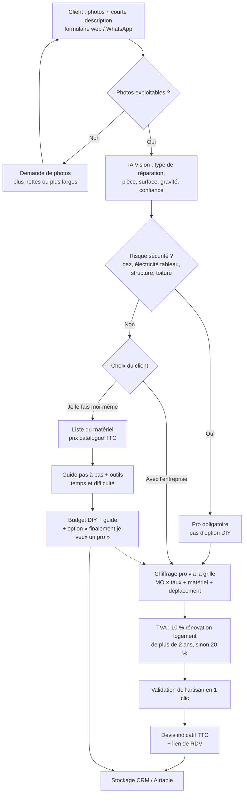

# 02 · Devis réparation maison par photo (n8n + IA Vision)

## Objectif
Le client photographie le problème (fuite, carrelage cassé, mur fissuré, porte qui frotte…), clique sur « Envoyer » et reçoit **deux budgets** :
- **Avec l'entreprise** : main-d'œuvre, matériel et déplacement, avec la TVA (TTC).
- **En le faisant lui-même** : liste du matériel avec les prix, temps estimé, difficulté et guide étape par étape.

## Schéma

## Explication étape par étape
1. **Envoi** : le client remplit un formulaire simple (photos et une phrase), envoyé à un webhook n8n.
2. **Contrôle des photos** : si elles sont floues ou trop serrées, un message automatique demande d'autres photos.
3. **Analyse IA** : le modèle renvoie un JSON (catégorie : plomberie, électricité, peinture, menuiserie ou maçonnerie ; élément touché ; surface estimée ; gravité ; confiance). **L'IA ne fixe aucun prix.**
4. **Filtre sécurité** : gaz, tableau électrique, structure et toiture imposent un professionnel. L'option « faire soi-même » n'est pas proposée.
5. **Avec l'entreprise** : un nœud Code applique la grille de l'artisan (taux horaire, temps par type d'intervention, matériel, déplacement).
6. **TVA** : 10 % pour des travaux d'amélioration ou d'entretien dans un logement de plus de 2 ans (attestation du client), 20 % sinon. Le taux de 5,5 % s'applique à la rénovation énergétique.
7. **Validation de l'artisan** : il approuve ou ajuste en un clic, puis le devis indicatif TTC part avec un lien de rendez-vous.
8. **Faire soi-même** : liste du matériel avec les prix (catalogue maintenu dans Google Sheets ou API d'enseigne), outils nécessaires, temps, difficulté sur 5 et tutoriel généré par l'IA.
9. **Retour possible** : un bouton « finalement je préfère un pro » renvoie vers le chiffrage de l'entreprise, ce qui permet de récupérer le lead.
10. **Suivi** : toutes les demandes sont stockées pour mesurer la conversion.

## Nœuds n8n principaux
`Webhook` → `IF` → `OpenAI` (vision) → `Code` (parse + règles sécurité) → `Switch` (pro / DIY) → `Google Sheets` (grille et catalogue) → `Wait` (validation) → `HTML to PDF` → `Email/WhatsApp` → `Airtable`.

## Garde-fous
- Les prix viennent de la grille de l'artisan et du catalogue, jamais de l'IA.
- Le prix est donné en fourchette avec la mention « estimation indicative, sous réserve de visite ».
- Le DIY est bloqué pour les interventions dangereuses ou réglementées.
- RGPD : consentement au stockage des photos et durée de conservation définie.
